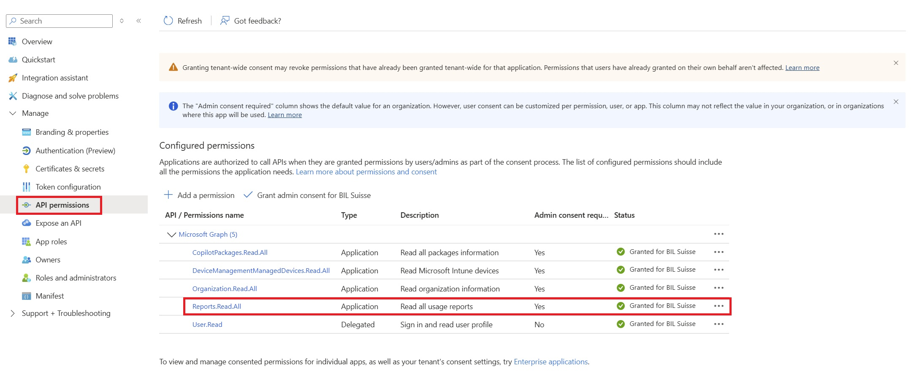
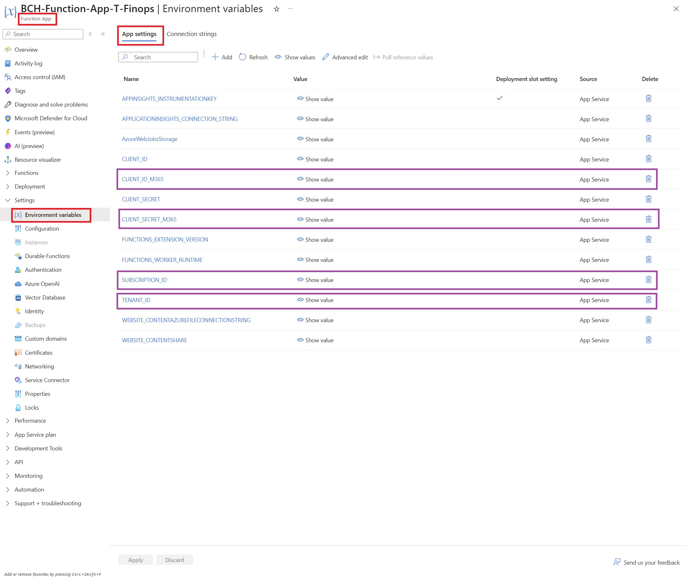
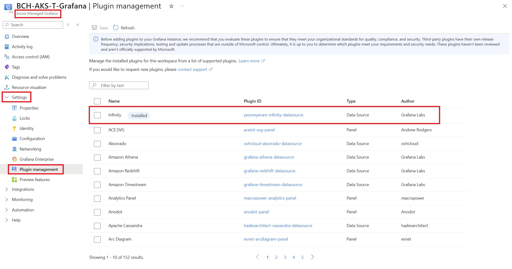
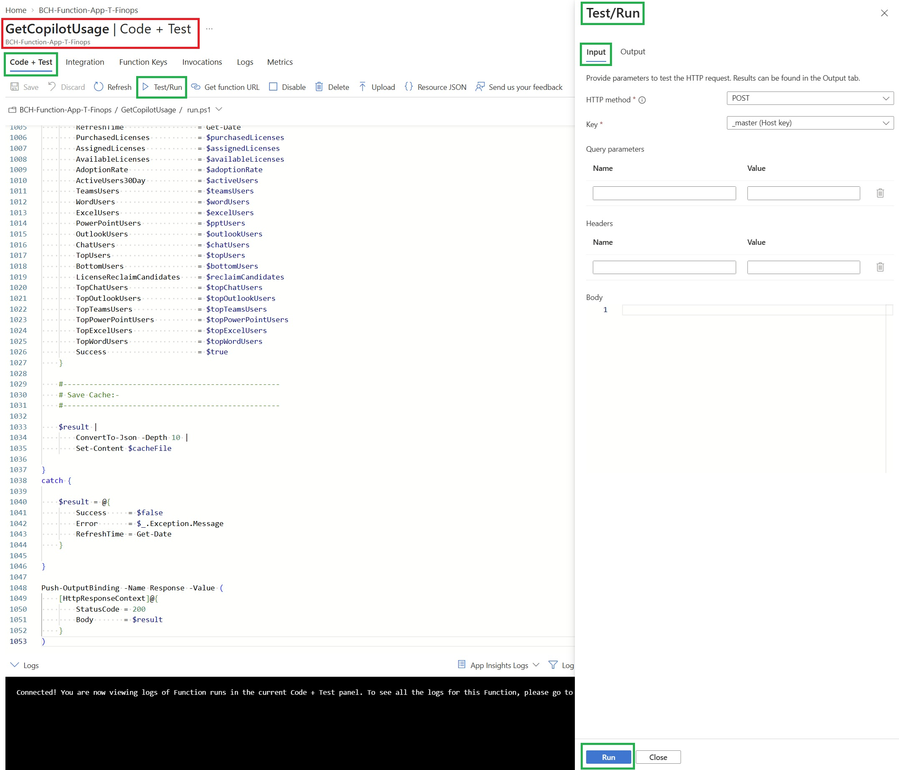
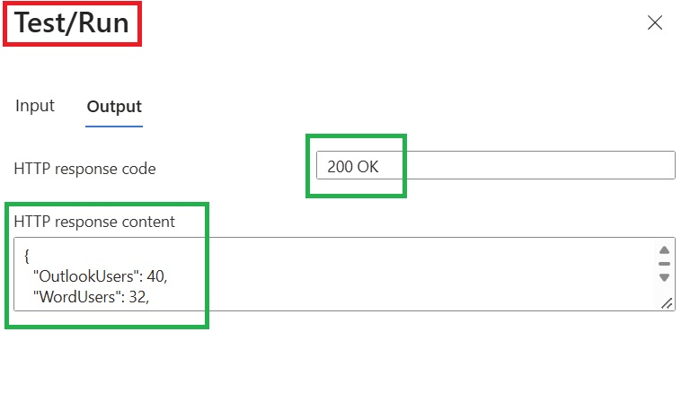
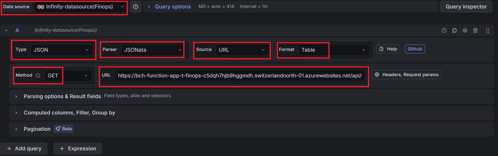
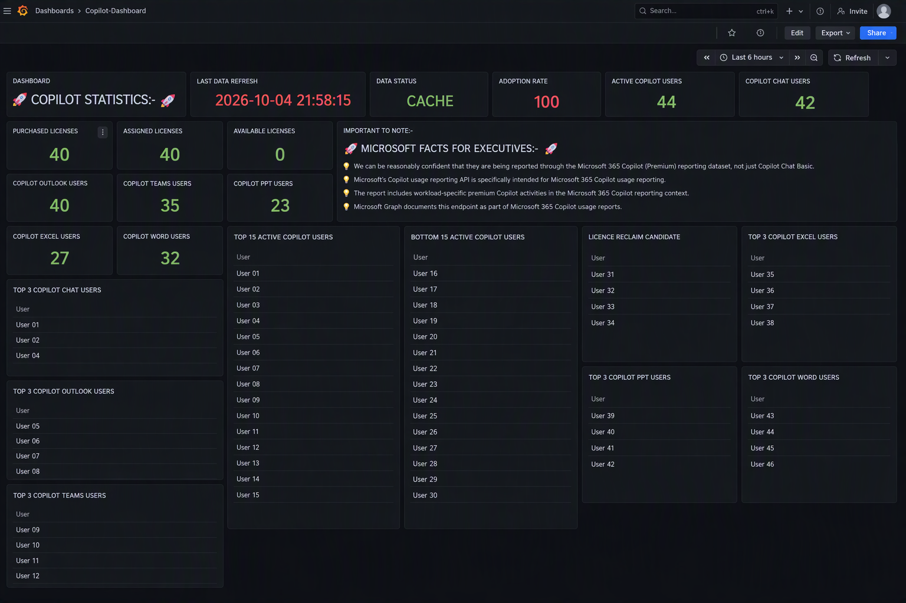

# Copilot License Statistics Dashboard:-

| BOM (Bill of Material):- |
| --------- |
| __Below Azure Services were used to create "Copilot License Statistics Dashboard":-__ |
| 1. App Registration |
| 2. App Service Plan |
| 3. Function App |
| 4. Application Insights |
| 5. Azure Managed Grafana |


| APP REGISTRATION:- |
| --------- |
| 1. Create "Secrets" |
| 2. Add Application API Permissions - "Application" |
|  |


| FUNCTION APP ENVIRONMENTAL VARIABLES DETAILS:- |
| --------- |
|  |


| FUNCTION TEMPLATE DETAILS:- |
| --------- |
| 1. Function Template = "HTTP Trigger" |
| 2. Function Name = "GetCopilotUsage" |
| 3. Authorization Level = "Function" |


| GRAFANA PLUGIN:- |
| --------- |
| 1. Name = "Infinity" |
| 2. Data Source = "Grafana Labs" |
|  |


| CODEBASE:- |
| --------- |
| 1. Powershell - "GetCopilotUsage.ps1" |

```
################################################################################################################################################################################################
# Management KPI API | Define Cache File | License Information | Top 5 | Bottom 5 | Active Inactive License Reclaim | Top 3 Chat, Outlook, Teams, PPT, Excel and Word Copilot Users:-
################################################################################################################################################################################################

using namespace System.Net

param($Request, $TriggerMetadata)

#--------------------
# Cache file:-
#--------------------

$cacheFile = "D:\home\data\copilot-cache-v1.json"

try {

    #--------------------------------------------------
    # Check Cache First:-
    #--------------------------------------------------

    if (Test-Path $cacheFile)
    {
        $cacheAge = (Get-Date) - (Get-Item $cacheFile).LastWriteTime

        if ($cacheAge.TotalMinutes -lt 60)
        {
            $cachedResult = Get-Content $cacheFile -Raw | ConvertFrom-Json

            $cachedResult.CacheStatus = "CACHE"

            Push-OutputBinding -Name Response -Value (
                [HttpResponseContext]@{
                    StatusCode = 200
                    Body       = $cachedResult
                }
            )

            return
        }
    }

    $body = @{
        client_id     = $env:CLIENT_ID_M365
        client_secret = $env:CLIENT_SECRET_M365
        scope         = "https://graph.microsoft.com/.default"
        grant_type    = "client_credentials"
    }

    $tokenResponse = Invoke-RestMethod `
        -Method Post `
        -Uri "https://login.microsoftonline.com/$($env:TENANT_ID)/oauth2/v2.0/token" `
        -Body $body

    $accessToken = $tokenResponse.access_token

    $headers = @{
        Authorization = "Bearer $accessToken"
    }

    #--------------------------------------------------
    # License Information:-
    #--------------------------------------------------

    $licenses = Invoke-RestMethod `
        -Method GET `
        -Headers $headers `
        -Uri "https://graph.microsoft.com/v1.0/subscribedSkus"

    # $copilotLicense = $licenses.value | Where-Object {
    #     $_.skuPartNumber -eq "Microsoft_365_Copilot"
    # }

    $copilotLicense = $licenses.value | Where-Object {
    $_.skuPartNumber -eq "Microsoft_365_Copilot"
        } | Select-Object -First 1

    if ($null -eq $copilotLicense)
    {
        throw "Microsoft_365_Copilot license SKU was not found."
    }

    # NEW: Save the current Copilot SKU ID
    $copilotSkuId = [string]$copilotLicense.skuId


    $purchasedLicenses = $copilotLicense.prepaidUnits.enabled
    $assignedLicenses  = $copilotLicense.consumedUnits
    $availableLicenses = $purchasedLicenses - $assignedLicenses

    #--------------------------------------------------
    # NEW: Get Current Entra Users
    #--------------------------------------------------

    $currentUsers = @()

    $usersUri = "https://graph.microsoft.com/v1.0/users?`$select=id,displayName,userPrincipalName,accountEnabled,userType,assignedLicenses&`$top=999"

    do
    {
        $usersResponse = Invoke-RestMethod `
            -Method Get `
            -Headers $headers `
            -Uri $usersUri

        if ($usersResponse.value)
        {
            $currentUsers += $usersResponse.value
        }

        $usersUri = $usersResponse.'@odata.nextLink'
    }
    while ($usersUri)

    # Keep only:
    # 1. Enabled users
    # 2. Member users, not guests
    # 3. Users currently assigned Microsoft 365 Copilot Premium

    $currentPremiumUsers = $currentUsers | Where-Object {

        $user = $_

        $hasCopilotPremium = @(
            $user.assignedLicenses | Where-Object {
                ([string]$_.skuId).ToLowerInvariant() -eq $copilotSkuId.ToLowerInvariant()
            }
        ).Count -gt 0

        $user.accountEnabled -eq $true -and
        $user.userType -eq "Member" -and
        $hasCopilotPremium
    }

    Write-Host "Current enabled Premium users: $($currentPremiumUsers.Count)"

    # Create a fast lookup table using UPN
    $currentPremiumUserLookup = @{}

    foreach ($user in $currentPremiumUsers)
    {
        if (-not [string]::IsNullOrWhiteSpace($user.userPrincipalName))
        {
            $normalizedUpn = $user.userPrincipalName.Trim().ToLowerInvariant()
            $currentPremiumUserLookup[$normalizedUpn] = $true
        }
    }

    #--------------------------------------------------
    # Copilot Usage:-
    #--------------------------------------------------

    $copilotData = Invoke-RestMethod `
        -Method GET `
        -Headers $headers `
        -Uri "https://graph.microsoft.com/v1.0/copilot/reports/getMicrosoft365CopilotUsageUserDetail(period='D7',version='v2')"

    #-------------------------------------------------- 
    # Convert CSV:-
    #--------------------------------------------------

    # $csvData = $copilotData | ConvertFrom-Csv

    # $activeUsers = $csvData.Count

    $allCopilotUsageData = @(
    $copilotData | ConvertFrom-Csv
    )

    Write-Host "Users returned by D7 usage report before filtering: $($allCopilotUsageData.Count)"

    #--------------------------------------------------
    # NEW: Keep Only Current Premium-Licensed Users
    #--------------------------------------------------

    $csvData = @(
        $allCopilotUsageData | Where-Object {

            $usageUpn = $_."User Principal Name"

            if ([string]::IsNullOrWhiteSpace($usageUpn))
            {
                return $false
            }

            $normalizedUsageUpn = $usageUpn.Trim().ToLowerInvariant()

            return $currentPremiumUserLookup.ContainsKey($normalizedUsageUpn)
        }
    )

    $activeUsers = $csvData.Count

    Write-Host "D7 users after current Premium-license filtering: $activeUsers"

    #-------------------------------------------------- 
    # Top 5 Most Recent Users:-
    #--------------------------------------------------

    $topUsers = $csvData |
    Sort-Object { [datetime]$_."Last Activity Date" } -Descending |
    Select-Object -First 5 `
        @{Name="User";Expression={$_. "Display Name"}},
        @{Name="LastActivity";Expression={$_. "Last Activity Date"}}

    #-------------------------------------------------- 
    # Bottom 5 Least Recent Users:-
    #--------------------------------------------------

    $bottomUsers = $csvData |
    Sort-Object { [datetime]$_."Last Activity Date" } |
    Select-Object -First 5 `
        @{Name="User";Expression={$_. "Display Name"}},
        @{Name="LastActivity";Expression={$_. "Last Activity Date"}}

    #-------------------------------------------------- 
    # License Reclaim Candidates:-
    #--------------------------------------------------

    $reclaimCandidates = $csvData | Where-Object {

    $_."Last Activity Date" -and
    ([datetime]$_."Last Activity Date") -lt (Get-Date).AddDays(-7)

    } | Select-Object `
        @{Name="User";Expression={$_. "Display Name"}},
        @{Name="LastActivity";Expression={$_. "Last Activity Date"}}

    #-------------------------------------------------- 
    # Top 3 Most Copilot Chat Users:-
    #--------------------------------------------------

    $topChatUsers = $csvData |
    Where-Object { $_."Copilot Chat Last Activity Date" } |
    Sort-Object { [datetime]$_."Copilot Chat Last Activity Date" } -Descending |
    Select-Object -First 3 `
        @{Name="User";Expression={$_. "Display Name"}},
        @{Name="LastActivity";Expression={$_. "Copilot Chat Last Activity Date"}}

    #-------------------------------------------------- 
    # Top 3 Most Copilot Outlook Users:-
    #--------------------------------------------------

    $topOutlookUsers = $csvData |
    Where-Object { $_."Outlook Copilot Last Activity Date" } |
    Sort-Object { [datetime]$_."Outlook Copilot Last Activity Date" } -Descending |
    Select-Object -First 3 `
        @{Name="User";Expression={$_. "Display Name"}},
        @{Name="LastActivity";Expression={$_. "Outlook Copilot Last Activity Date"}}

    #-------------------------------------------------- 
    # Top 3 Most Copilot Teams Users:-
    #--------------------------------------------------

    $topTeamsUsers = $csvData |
    Where-Object { $_."Microsoft Teams Copilot Last Activity Date" } |
    Sort-Object { [datetime]$_."Microsoft Teams Copilot Last Activity Date" } -Descending |
    Select-Object -First 3 `
        @{Name="User";Expression={$_. "Display Name"}},
        @{Name="LastActivity";Expression={$_. "Microsoft Teams Copilot Last Activity Date"}}

    #-------------------------------------------------- 
    # Top 3 Most Copilot Powerpoint Users:-
    #--------------------------------------------------

    $topPowerPointUsers = $csvData |
    Where-Object { $_."PowerPoint Copilot Last Activity Date" } |
    Sort-Object { [datetime]$_."PowerPoint Copilot Last Activity Date" } -Descending |
    Select-Object -First 3 `
        @{Name="User";Expression={$_. "Display Name"}},
        @{Name="LastActivity";Expression={$_. "PowerPoint Copilot Last Activity Date"}}

    #-------------------------------------------------- 
    # Top 3 Most Copilot Excel Users:-
    #--------------------------------------------------

    $topExcelUsers = $csvData |
    Where-Object { $_."Excel Copilot Last Activity Date" } |
    Sort-Object { [datetime]$_."Excel Copilot Last Activity Date" } -Descending |
    Select-Object -First 3 `
        @{Name="User";Expression={$_. "Display Name"}},
        @{Name="LastActivity";Expression={$_. "Excel Copilot Last Activity Date"}}

    #-------------------------------------------------- 
    # Top 3 Most Copilot Word Users:-
    #--------------------------------------------------

    $topWordUsers = $csvData |
    Where-Object { $_."Word Copilot Last Activity Date" } |
    Sort-Object { [datetime]$_."Word Copilot Last Activity Date" } -Descending |
    Select-Object -First 3 `
        @{Name="User";Expression={$_. "Display Name"}},
        @{Name="LastActivity";Expression={$_. "Word Copilot Last Activity Date"}}

    #-------------------------------------------------- 
    # Count:-
    #--------------------------------------------------    

    $teamsUsers = ($csvData | Where-Object {
        $_."Microsoft Teams Copilot Last Activity Date"
    }).Count

    $wordUsers = ($csvData | Where-Object {
        $_."Word Copilot Last Activity Date"
    }).Count

    $excelUsers = ($csvData | Where-Object {
        $_."Excel Copilot Last Activity Date"
    }).Count

    $pptUsers = ($csvData | Where-Object {
        $_."PowerPoint Copilot Last Activity Date"
    }).Count

    $outlookUsers = ($csvData | Where-Object {
        $_."Outlook Copilot Last Activity Date"
    }).Count

    $chatUsers = ($csvData | Where-Object {
        $_."Copilot Chat Last Activity Date"
    }).Count

    #--------------------------------------------------
    # License Calculation:-
    #--------------------------------------------------

    if ($assignedLicenses -gt 0)
    {
        $adoptionRate = [Math]::Round(($activeUsers / $assignedLicenses) * 100, 1)

        # Cap at 100%:-

            if ($adoptionRate -gt 100)
            {
                $adoptionRate = 100
            }
    }
    else
    {
        $adoptionRate = 0
    }

    #--------------------------------------------------
    # Build Result:-
    #--------------------------------------------------

    $result = @{
        CacheStatus                     = "FRESH"
        RefreshTime                     = Get-Date
        ReportingPeriod                 = "D7"

        PurchasedLicenses               = $purchasedLicenses
        AssignedLicenses                = $assignedLicenses
        AvailableLicenses               = $availableLicenses
        
        CurrentPremiumLicensedUsers     = $currentPremiumUsers.Count
        UsageUsersBeforeLicenseFilter   = $allCopilotUsageData.Count
        UsageUsersAfterLicenseFilter    = $activeUsers

        AdoptionRate                    = $adoptionRate

        ActiveUsers30Day                = $activeUsers
        
        TeamsUsers                      = $teamsUsers
        WordUsers                       = $wordUsers
        ExcelUsers                      = $excelUsers
        PowerPointUsers                 = $pptUsers
        OutlookUsers                    = $outlookUsers
        ChatUsers                       = $chatUsers
        TopUsers                        = $topUsers
        BottomUsers                     = $bottomUsers
        LicenseReclaimCandidates        = $reclaimCandidates
        TopChatUsers                    = $topChatUsers
        TopOutlookUsers                 = $topOutlookUsers
        TopTeamsUsers                   = $topTeamsUsers
        TopPowerPointUsers              = $topPowerPointUsers
        TopExcelUsers                   = $topExcelUsers
        TopWordUsers                    = $topWordUsers

        Success                         = $true
    }

    #--------------------------------------------------
    # Save Cache:-
    #--------------------------------------------------

    $result |
        ConvertTo-Json -Depth 10 |
        Set-Content $cacheFile

}
catch {

    $result = @{
        Success     = $false
        Error       = $_.Exception.Message
        RefreshTime = Get-Date
    }

}

Push-OutputBinding -Name Response -Value (
    [HttpResponseContext]@{
        StatusCode = 200
        Body       = $result
    }
)
```

| TESTING - LOCAL RUN:- |
| --------- |
|  |
|  |


| GRAFANA PANEL CONFIG:- |
| --------- |
|  |


| GRAFANA DASHBOARD - COPILOT LICENSE USAGE:- |
| --------- |
|  |
