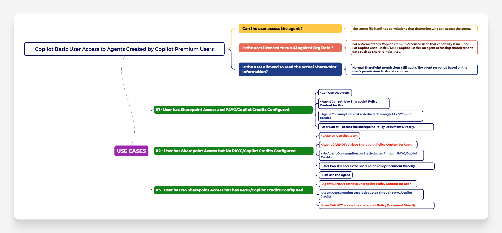

# FACTORS: M365 COPILOT BASIC USER ACCESS TO AGENTS CREATED BY COPILOT PREMIUM USERS:-

| IMPORTANT TO NOTE:- |
| --------- |
| For the sake of this blog post, I have considered that __"SharePoint"__ as document Repository. |

| IMPORTANT QUESTIONS TO UNDERSTAND THE CONCEPT:- |
| --------- |
| 1. __Can the user access the agent ?__ |
| 2. __Is the User licensed to run AI against Org Data ?__ |
| 3. __Is the User allowed to read the actual SharePoint Information ?__ |

| USE CASES TO UNDERSTAND WHEN M365 COPILOT BASIC USER CAN or CANNOT ACCESS AGENTS CREATED BY COPILOT PREMIUM USERS:- |
| --------- |
| 1. __User has SharePoint Access and PAYG/Copilot Credits Configured.__ |
| 2. __User has SharePoint Access but No PAYG/Copilot Credits Configured.__ |
| 3. __User has No SharePoint Access but has PAYG/Copilot Credits Configured.__ |

| ALL DETAILS DESCRIBED IN THE MINDMAP:- |
| --------- |
|  |

