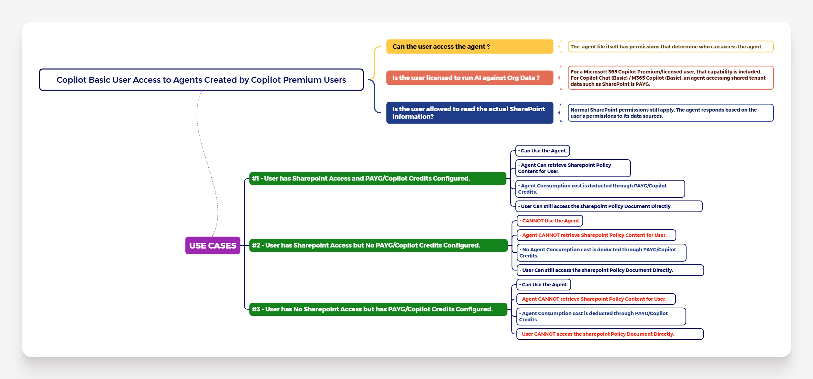

# FACTORS: M365 Copilot Basic User Access to Agents Created by Copilot Premium Users:-

| IMPORTANT TO NOTE:- |
| :--------- |
| For the sake of this blog post, I have considered that __"SharePoint"__ as document Repository. |

| IMPORTANT QUESTIONS TO UNDERSTAND THE CONCEPT:- |
| :--------- |
| 1. Can the user access the agent ? |
| 2. Is the User licensed to run AI against Org Data ? |
| 3. Is the User allowed to read the actual SharePoint Information ? |

| USE CASES TO UNDERSTAND WHEN M365 COPILOT BASIC USER CAN or CANNOT ACCESS AGENTS CREATED BY COPILOT PREMIUM USERS:- |
| :--------- |
| 1. User has SharePoint Access and PAYG/Copilot Credits Configured. |
| 2. User has SharePoint Access but No PAYG/Copilot Credits Configured. |
| 3. User has No SharePoint Access but has PAYG/Copilot Credits Configured. |

| ALL DETAILS DESCRIBED IN THE MINDMAP:- |
| :---------: |
|  |

